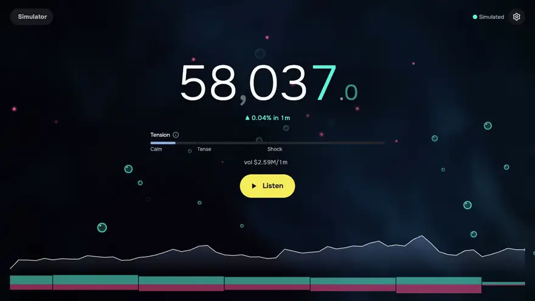
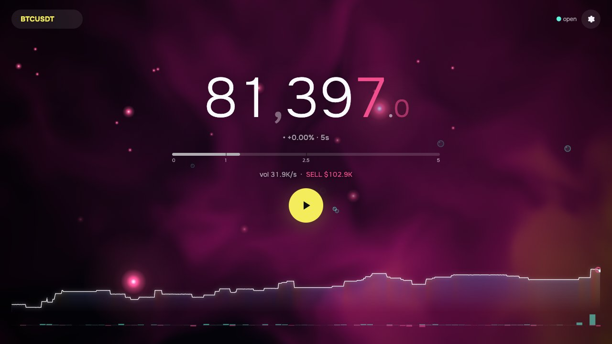
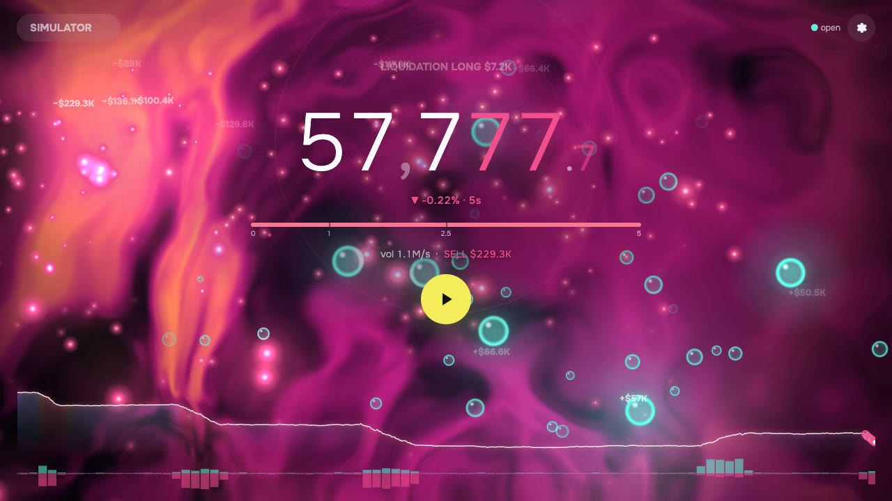

<p align="center">
  
</p>

<h1 align="center">Crypto Tune</h1>

<p align="center">
  <b>Hear the market.</b><br>
  Live crypto futures turned into calm generative music that tightens when price moves.
</p>

<p align="center">
  <a href="https://dmitrytut.github.io/crypto-tune/"><b>▶&nbsp;Open the live demo</b></a>
  &nbsp;·&nbsp; runs in the browser &nbsp;·&nbsp; no sign-up, no API keys, no backend
</p>

<p align="center">
  <a href="https://github.com/dmitrytut/crypto-tune/actions/workflows/deploy.yml"></a>
  
  
  
</p>

<p align="center">
  <a href="https://dmitrytut.github.io/crypto-tune/"></a><br>
  <sub>A simulated sell-off. Sound on in the app: here you only see it.</sub>
</p>

Charts need your eyes. Crypto Tune only needs your ears. Leave it in a background tab while you work.
A quiet market is an ambient drone with slow bells. When price jumps, the music speeds up, the filters
open and the bass comes in. Liquidations hit like gongs. You hear the shock before you would have
looked at the chart.

## Highlights

- **Calm by default.** A soft drone drifting through a six-chord cycle, a minor-pentatonic arpeggio
  and Eno-style bell loops. Pleasant enough to keep on for hours.
- **Tension you can hear.** Price shocks and volume spikes raise the tempo from 60 to 90 BPM, open
  the filters and bring in a sub bass and a shaker. Past the red line come double time, a noise riser
  and a detuned drone.
- **Direction in the melody.** When price rises, the arpeggio climbs and gets brighter. When it falls,
  the arpeggio descends and gets darker.
- **Every whale and every wipe-out.** Liquidations sound as FM gongs, big market trades as plucks.
  Each sits where it belongs in the stereo field: buys to the right, sells to the left.
- **A living picture.** A WebGL aura takes its colour from order flow. Buys float up as bubbles, sells
  sink as drops, and liquidations send shockwaves out of the price. A price and volume strip runs
  along the bottom, over the period you pick: 1m, 5m, 15m or 1h.
- **Ready in seconds.** The last 30 minutes of trades load on connect and are cached in IndexedDB,
  so tension is calibrated almost at once instead of after a five-minute warm-up.
- **Glanceable.** The tab title reads `▲ 81,305.2 · BTCUSDT · tension 2.6`. After 10 s without input
  the UI fades out, leaving only the aura, the price and the chart.
- **Any Binance USDⓈ-M perpetual.** You can also switch to the built-in simulator to hear a sell-off
  on demand.

| Live BTCUSDT, buyers in control                    | Simulator, liquidation cascade                                 |
| -------------------------------------------------- | -------------------------------------------------------------- |
|  |  |

## Quick start

Open **<https://dmitrytut.github.io/crypto-tune/>** and press **Listen**. Browsers only start audio
after a click.

To run it locally:

```sh
pnpm install
pnpm dev        # http://localhost:5173
```

## How it works

```
Binance WebSocket ─┐                    ┌─► audio: Tone.js layers → reverb → compressor → limiter
  (aggTrade,       ├─► feed ─► metrics ─┤
   forceOrder)     │   Trade,   250 ms  └─► view: price, tension meter, WebGL aura, particles, chart
REST aggTrades ────┘   Liquidation  ticks
  + IndexedDB cache
```

Plain TypeScript with Vite and no framework. Tone.js handles audio, and the aura is raw WebGL. All
computation runs in the browser, which talks to Binance directly.

### Data sources

- **LIVE**: Binance Futures public WebSocket `wss://fstream.binance.com/market/stream` (`aggTrade` +
  `forceOrder`). The pair can be picked from the list of trading perpetuals. On connect the last
  30 min of trades come from REST (`/fapi/v1/aggTrades`, up to 20 requests) and are stitched to the
  live stream by trade id. The last 30 min per pair live in IndexedDB (written every 30 s and when the
  tab is hidden), so a reload usually fetches only the gap, in one request. If neither history nor
  cache answers within 1.5 s, metrics warm up on live data. The socket reconnects with exponential
  backoff and jitter, and is recreated after 15 s of silence or a stuck connect.
- **SIMULATOR**: a synthetic market. Calm stretches (1.5–5 min) alternate with impulses (15–90 s,
  0.3–1.5 % moves with bursts of volume and liquidations). It generates 30 min of history at start, so
  no warm-up is needed.

### Tension

Recomputed every 250 ms on the feed clock, never wall time:
- `ret = log(p / p[N s ago])`, `z = ret / std(ret over 30 min)`; `volZ` is the z-score of per-second
  volume.
- `raw = sensitivity × max(|z|, 0.7 · volZ)`, then asymmetric smoothing: fast attack 0.4, slow
  release 0.03.
- `direction` is the smoothed `sign(ret)`. The window N defaults to 5 s.
- Without history, the warm-up lasts N + 5 min and the UI counts it down
  (`calibrating · m:ss`).

Design notes and decisions: [`docs/plan.md`](docs/plan.md).

### Sound

- **Base** (always on): a drone on the root and fifth whose filter slowly breathes. Every 16 bars it
  moves to the next chord of i → VI → iv → i → III → VII (6 s crossfade, about 6 min per cycle). On
  top runs a minor-pentatonic arpeggio, one note per beat, with a light echo. In a calm market it
  skips weak beats; the line fills in as tension grows. Three quiet bells repeat one note each every
  7, 11 and 13 beats (Eno-style loops, so the whole pattern recurs only every ~17 min), and a soft
  pulse marks each beat. Everything goes through a long reverb, a compressor and a −1 dBFS limiter.
- **Register** follows `vs EMA 1h`, the price's distance from its hourly EMA in units of its spread:
  up to ±3 scale steps, with hysteresis so notes don't flicker at a boundary.
- **Tension zones**:
  - below 1: base only;
  - 1–2.5: the arpeggio filter opens (1 → 6 kHz), tempo rises 60 → 90 BPM, a pulsing sub bass on the
    tonic and a quiet eighth-note shaker come in (the sub is already at half level around 1.5);
  - above 2.5: a noise riser with a climbing band, arpeggio vibrato, the drone root bends down
    against the fifth (beating), and the arpeggio switches to eighths from the next beat.
- **Shock**: when tension rises by 3.5 within ~1 s, a noise swell sweeps up the filter on a rally
  and down on a drop. At most once per 20 s, about 5 times an hour on a quiet BTCUSDT.
- **Direction**: on a rise the arpeggio runs up the scale, higher and brighter; on a fall it runs
  down, lower and darker. The contour changes from the next note and continues from the last step.
- **Events**:
  - a liquidation above the threshold (default $20K) is an FM gong: a LONG (forced sell, price
    falling) is a low dark gong on the tonic, a SHORT is a bright bell on the fifth an octave up;
  - a market trade above the threshold (default $200K) is a short pluck, BUY high and right, SELL low
    and left;
  - loudness grows with log size, from quiet at the threshold to full at 100× the threshold;
  - cascades collapse to at most one hit per kind per 250 ms tick; the side with more volume wins.
    The latest event is shown under the meter with its age (`LIQ LONG $766K (12s ago)`), even with
    sound off, and fades out after a minute;
  - thresholds are shared by all pairs, so lower them for small pairs.
- Every change is smooth: levels and filters ramp over 0.5 s, tempo moves in 1 BPM steps, double time
  lands on the beat and chord changes on bar lines. Tonic, the three layer volumes and both
  thresholds are configurable; a tonic change glides the drone and sub over 3 s.

### Visuals

The main screen works like "now playing" (the whole UI is in English): a large price, its change over
the chosen period below it (`▼ 0.11% in 15m`), the **Tension** meter with Calm / Tense / Shock zones
(`calibrating · 4:52` on the right during warm-up), dollar volume over the same period
(`vol $90.9M/15m`), the latest event, and the **Listen** / **Stop** button. The tooltip on `Tension`
(hover, focus or tap) explains what the meter measures and how each zone sounds. Until data arrives,
the line under the meter says what it is waiting for (`Connecting to the market…`,
`Loading recent trades…`), and the status in the top right is in words (`Live`, `Connecting…`).
Sound, sensitivity and source live in settings (⚙); every setting has an ⓘ tip that says in a line
what it is and what it changes. The pair chip in the top left always shows its border and arrow; a click opens a searchable
list. Pair and tonic share one dropdown component (`ui/components/picker/`): arrows and Enter pick, Esc or a
click outside closes. There is no visible title; the `h1` is for screen readers only. Style: opaque
surfaces without blur or glow, the yellow accent only on the sound button, Lucide icons, one white
focus ring on every control. Plain CSS: design tokens (palette, type scale, spacing, radii,
shadows, motion, stacking) in `src/ui/styles/tokens.css`, cascade layers
`base → page → components → utilities`, each component's stylesheet next to its code.
- **Aura** (WebGL shader) reacts from the first trade, with no warm-up:
  - **order flow** (last ~4 s): buying pressure turns the field teal and lifts it; selling pressure
    turns it magenta and amber and pushes it down. The busier trading is relative to the last 2 min,
    the faster and brighter it flows;
  - **tension** (after warm-up): a sustained move tears the field into turbulence and saturates it;
  - a volume spike brightens it, and price above the hourly EMA lifts the glow;
  - at rest: a cool steel blue breathing in time with the drone.
- **Every buy is a bubble** rising from the chart, **every sell a drop** falling from the top. Buys sit
  slightly right and sells left, as in the stereo mix. Size grows with log notional, from 4 px at $1K
  to 22 px at $1M. Trades above the threshold get a halo, a floating amount (`+$864K`) and a flash in
  the aura. In a cascade small particles merge, so frames don't drop.
- **Every liquidation** is a double ring from the price (LONG magenta, SHORT teal). Above the
  threshold it adds shards, a `LIQUIDATION LONG $1.2M` label and a shockwave that bends the aura; at
  10× the threshold, a light screen shake. Small liquidations leave faint rings, so you can watch a
  cascade build.
- **Price** uses thin tabular digits with fixed precision per pair, so the width never jumps. Only the
  digits that changed flash. Film grain sits over everything.
- **Chart** over the same period: a glow under the line coloured by tension, buy volume up and sell
  volume down per 10 s, and event dots. Hovering a dot (or tapping it on a phone) shows what it was
  and when, in one line: `SELL $603K 03:57:03`. While history is shorter, the chart stretches over
  what there is (at least 30 s).
- **Period** (settings → Period): 1m, 5m, 15m or 1h, one for price change, volume and chart; it is
  remembered. While history is shorter than the period, everything uses what there is and the label
  shows the real span (`in 26m`). History is kept for up to an hour; on LIVE about 30 min are loaded
  on connect, and it grows from there.
- **Tab title**: `▲ 81,305.2 · BTCUSDT · tension 2.6`, so the state is visible without switching tabs.
- **Immersive mode**: after 10 s without mouse or keyboard the UI fades out, leaving the aura, the
  price and the chart.
- `prefers-reduced-motion`: the aura is nearly still, and there are no bubbles, rings, waves, shake
  or flashes.

## Development

| Command          | What it does                                   |
| ---------------- | ---------------------------------------------- |
| `pnpm dev`       | dev server on `localhost:5173`                 |
| `pnpm test`      | unit tests (vitest)                            |
| `pnpm typecheck` | type check (TypeScript 7)                      |
| `pnpm check`     | Biome lint + format check                      |
| `pnpm build`     | type check + production bundle in `dist/`      |
| `pnpm preview`   | serve `dist/` on `localhost:4173/crypto-tune/` |

Before committing: `pnpm check && pnpm test && pnpm build`. Code layout, module boundaries and
conventions are in [`AGENTS.md`](AGENTS.md).

**Deploy.** Every push to `master` builds the site and publishes it to GitHub Pages
([`.github/workflows/deploy.yml`](.github/workflows/deploy.yml): check, test, build, upload
`dist/`). The site lives under `/crypto-tune/`, which is why `vite.config.ts` sets `base`. To redeploy
by hand: Actions → Deploy to GitHub Pages → Run workflow.

**Link previews.** Open Graph and Twitter card tags in `index.html` point at `public/og.jpg`
(1200×630). Crawlers need absolute URLs, so those tags hard-code
`https://dmitrytut.github.io/crypto-tune/`; update them if the site moves.

## Status

- [x] **Stage 1**: feed (Binance, any pair) + simulator + metrics + numeric UI
- [x] **Stage 2**: base sound layer
- [x] **Stage 3**: tension layer
- [x] **Stage 4**: events (liquidations, large trades)
- [x] **Sound v2**: history instead of warm-up, on-the-beat reactions, shock swell, chord drift, bell
  loops, pulse
- [x] **Stage 5**: visuals (aura, particles, chart, settings dialog)
- [x] **Design cleanup** (per taste-skill): title and labels, a text button, no glass/glow/neon
- [x] **Publishing**: GitHub Pages via Actions, logo and favicon

Replay (record and play back) and a MEXC adapter were dropped: the simulator is enough for tuning the
sound, and Binance covers the pairs that matter.

<details>
<summary><b>Manual checks per stage</b></summary>

### Design cleanup

1. `pnpm dev`: the first screen shows the price, the `… in 15m` change, the meter and the **Listen**
   button; while history loads, text sits under the meter instead of a blank.
2. Hovering or tapping `Tension ⓘ` shows the tooltip with zones; Esc or a tap outside closes it.
3. The pair chip always has a border and an arrow; a click opens the list with search, `eth` →
   `ETHUSDT` with arrows and Enter; an unknown pair gives `No such pair on Binance Futures`; the
   simulator has no arrow. The tonic in settings opens the same list; Esc closes the list, not the
   dialog.
4. No blur under the chip, buttons or dialog; no glow on the sound button or the chart line; at rest
   the aura is blue, not violet.
5. Settings headings are in sentence case, the source reads `Live` / `Simulator`; hovering or tapping
   any ⓘ in settings shows its tip, and Esc closes the tip first, then the dialog.

### Stage 5

1. `pnpm test`: includes chart history (price per second, buy/sell volume per 10 s, 1 h trim),
   the aura palette (colour by direction, speed by tension, brightness by volume) and particle merging
   under load.
2. `pnpm dev` → LIVE: the aura changes colour and motion within seconds; buy bubbles rise from the
   bottom, sell drops fall from the top.
3. ⚙ → SIMULATOR, sensitivity ×2. On a down impulse the aura turns magenta and tears, drops rain from
   the top, rings with shards and a liquidation label spread from the price, and the aura bends with
   the wave.
4. The settings dialog opens from the keyboard (Tab → ⚙ → Enter) and closes on Esc and on a click
   outside.
5. The tab title shows price and direction; after 10 s of inactivity the UI fades out.

### Sound v2

1. `pnpm test`: includes Binance history loading (time order, stitching with the stream by id, request
   limit, fallback on error), contour continuation from the next note, the shock detector (sharp
   rise, slow rise, cooldown, gap in updates) and the mid-zone curves.
2. `pnpm dev` → LIVE BTCUSDT: price, tension and "warm-up done" appear ~5 s after opening.
3. **Start** on SIMULATOR: a soft pulse on every beat, a bell every few seconds; after about a minute
   the drone moves to another chord without a glissando.
4. During a simulator impulse: a noise swell on the sharp entry, the arpeggio immediately runs in the
   direction of the move and doubles from the next beat above 2.5.
5. **Stop** then **Start** right away: the music continues (loops used to fall silent).

### Stage 4

1. `pnpm test`: cascade collapsing (the side with more volume wins, stale events are dropped),
   loudness by size, voice placement (LONG below SHORT, BUY above and right of SELL).
2. `pnpm dev` → SIMULATOR → **Start**. On a down impulse low gongs and left-side plucks sound, and the
   event line shows `LIQ LONG …` and `SELL …` in red; on an up impulse the opposite.
3. LIVE BTCUSDT: trades above $200K happen several times a minute. Threshold sliders move on a log
   scale ($1K–$1M and $10K–$10M).
4. The Events slider changes only gongs and plucks.

### Stage 3

1. `pnpm test`: includes tension → sound parameter mapping (zones, double time with hysteresis,
   direction, continuity without jumps) and arpeggio contours.
2. `pnpm dev` → SIMULATOR → sensitivity ×3 → **Start**. Past 1 on the meter the filter opens, tempo
   rises, sub and shaker come in. Past 2.5 come noise, a wavering arpeggio and double time. After the
   impulse everything glides back to the base.
3. On an up impulse (▲) the arpeggio runs up and sounds brighter; on a down impulse (▼) the opposite.
4. The Tension slider changes only this layer.

### Stage 2

1. `pnpm test`: includes EW mean and EW variance, `emaZ` in the engine, the scale, the arpeggio
   pattern and register hysteresis.
2. `pnpm dev` → SIMULATOR → **Start**: sound fades in over ~3 s; **Stop** fades out over 1.5 s.
3. Change the tonic: the drone glides to the new note without a click.
4. The base volume slider changes the level smoothly.
5. After a simulator rally the arpeggio sits higher, after a sell-off lower: the register follows the
   price's distance from its hourly EMA.
6. On LIVE the register follows the EMA immediately (history from REST).

### Stage 1

1. `pnpm test`: rolling std, z-score, asymmetric smoothing, tension, the metrics engine, Binance
   parsers and reconnection.
2. `pnpm dev` → LIVE: status `Live`, the price updates; the tension meter comes alive within seconds
   (history from REST; without it, a ~5 min warm-up with a countdown).
3. Change the pair (e.g. `ETHUSDT`): label and price switch, warm-up restarts. An unknown pair: the
   pair list shows `No such pair on Binance Futures`.
4. SIMULATOR: metrics are ready at once. An impulse starts every 1.5–5 min, tension climbs above
   1–2.5, and direction shows its sign.
5. DevTools → Network → Offline: the status shows "retrying in Ns" with a growing delay. Back online:
   the status is `Live` again.
6. Reload the page: source, pair, window N and sensitivity are kept.

</details>
